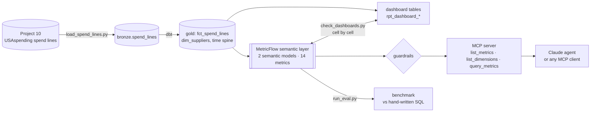

# "Ask the Warehouse": Semantic Layer + AI Agent

[](https://github.com/Saigwe/ask-the-warehouse/actions/workflows/ci.yml)

> 14 metrics defined once in a dbt semantic layer (MetricFlow) over $6.57B of real federal contract spend. An automated check that dashboard numbers equal the semantic layer to the cent, and catches a planted wrong dashboard. An MCP server that gives an AI agent the metrics and no SQL, with guardrails, scored on a 54-question benchmark with hand-written answers.

**Author:** Stanley Igwe, Lead Data (Analytics) Engineer · [Portfolio](https://saigwe.github.io)
**Stack:** dbt Core · dbt Semantic Layer (MetricFlow 0.213) · MCP (Python SDK 2.x) · Claude (Anthropic SDK) · DuckDB · pytest · GitHub Actions
**Status:** Core build complete on real data. The Claude agent run on the benchmark needs an API key and is the next step. See [Roadmap](#roadmap).

Project 12 of my portfolio plan. At a global management consultancy I built governed metrics, plus Power BI data-validation and measure-optimisation models, so every client saw the same numbers. This repo rebuilds the problem on public data. No employer or client data, code or logic is used.

---

## 90-second summary
| | |
|---|---|
| **Problem** | "Spend" means three different numbers on three dashboards (gross, net, net of credits), and a chatbot over raw tables invents a fourth. Nobody can say which is right. |
| **What I built** | Metrics defined once in MetricFlow. A reconciliation check that every dashboard cell equals the governed metric. An MCP server whose only tools are *list metrics*, *list dimensions* and *query metrics*, behind guardrails that reject undefined metrics, raw columns, SQL in filters and bulk exports. A Claude agent loop over the same tools, and a benchmark whose answers are written in plain SQL, separately from the semantic layer. |
| **Why it matters** | An analyst, a dashboard and an AI assistant get the same answer to "how much did the Park Service spend?", and a wrong dashboard fails CI instead of reaching a board pack. |
| **Proof** | [Numbers](#numbers). Benchmark and dashboard reports in [`results/`](results); CI reruns all of it on every push. |

## Architecture


## Data
Real: the 41,980 categorised contract actions from [project 10](https://github.com/Saigwe/procurement-spend-cube) (USAspending.gov, Department of the Interior, federal FY2025, public domain), loaded by [`ingestion/`](ingestion). CI uses a synthetic fixture with the same columns and vocabulary.

## Semantic layer
| Metric | Type | Definition |
|---|---|---|
| `net_spend` | simple | Obligations minus de-obligations: *the* definition of spend |
| `gross_obligations`, `deobligations` | simple | New money obligated; money returned (negative) |
| `contract_actions`, `obligation_actions`, `active_suppliers` | simple | Actions; obligating actions; distinct UEIs |
| `not_competed_share`, `small_business_share` | ratio | Over obligations where competition / size is recorded |
| `average_obligation` | ratio | Gross obligations per obligating action |
| `deobligation_rate` | derived | −de-obligations / gross obligations |

Dimensions: bureau, category, fiscal quarter, competition status, business size, supplier and parent supplier, and `metric_time` at day to year grain. The four numerator and denominator helpers make up the rest of the 14.

## Guardrails (in `agent/semantic_layer.py`, checked before anything is compiled)
- Only metrics defined in `_semantic.yml`; only dimensions MetricFlow lists for those metrics.
- Filters must be `{{ Dimension('x') }} <op> <literal>` joined by and/or. Raw columns, SQL keywords, `;`, comments and tautologies like `or 1 = 1` are rejected.
- At most 5 metrics, 3 group-bys and 500 rows: it answers questions; it does not export data.
- There is no tool that runs SQL. Refusals come back as readable tool errors, so the agent can correct itself.

## Numbers
All from the real build (`make all`) unless marked.

| Metric | Value |
|---|---|
| Spend lines | 41,980 contract actions, $6.57B net |
| dbt build | 25 nodes (7 models, 18 data tests) in 1.9 s, plus 2 semantic models and 14 metrics |
| Benchmark, reference requests through the semantic layer | **44/44** answers equal the hand-written SQL |
| Benchmark, requests that must be refused | **10/10** refused by the guardrails |
| Query latency through MetricFlow | p50 17 ms, p95 26 ms (laptop, DuckDB) |
| Dashboard check | 8 dashboard columns, 258 cells, all equal to the cent; the planted legacy dashboard is caught on all 22 of its cells |
| Tests (`pytest`) | 15 pass: guardrail cases, the MCP server over an in-process client, and the agent loop with scripted Claude replies |
| Claude agent on the benchmark | **not run yet** (needs an API key; see Roadmap) |

The planted legacy dashboard makes the two classic mistakes. It shows gross obligations as "spend" (Bureau of Indian Affairs: $408.7M on the dashboard vs $365.7M governed net). And it computes small-business share on net instead of obligated amounts (73.1% vs 72.8%). The check fails CI if it ever stops catching them.

**What the reference benchmark proves, and what it doesn't:** it shows the metric definitions, the time spine joins, the filters and the guardrails produce the right numbers for 44 realistic questions, and refuse 10 bad requests. It does not yet measure how often an LLM picks the right request. That is `make agent-eval`, which scores Claude through the same tools against the same answers.

## How to run
Requires **Python 3.12** (what CI uses) and `make`, or run the commands in the `Makefile` by hand.
```bash
python -m venv .venv && source .venv/bin/activate   # Windows: .venv\Scripts\activate
pip install -r requirements.txt
make fixture-all          # synthetic fixture: dbt build, benchmark, dashboard check, tests (CI)
make all                  # real data from ../procurement-spend-cube (build it first)
make mcp                  # serve the metrics over MCP (stdio), e.g. for Claude Code or Claude Desktop
make agent-eval           # Claude agent on the benchmark: needs ANTHROPIC_API_KEY, about 54 short agent runs
```

## Roadmap
- [x] Scaffold: fixture, staging with key tests, first marts, CI
- [x] Define the metrics once (MetricFlow semantic models, 14 metrics) on real USAspending data
- [x] Automated test that dashboard numbers equal semantic-layer numbers, with a planted bug it must catch
- [x] Expose metrics to an LLM through an MCP server, with no raw-table access and guardrails
- [x] Benchmark of 54 questions (44 answerable, 10 to refuse) with hand-written gold SQL; accuracy and latency tracked in CI
- [ ] Run the Claude agent on the benchmark and report execution accuracy, refusal accuracy, latency and cost per question
- [ ] Saved queries and a Power BI or Evidence.dev front end reading the same metrics
- [ ] 3-minute Loom walkthrough

## Interview topics this project prepares
- Semantic layers and metric governance (MetricFlow: measures, ratio and derived metrics, time spines)
- Testing BI numbers against a single source of truth
- LLM-to-data evaluation: execution accuracy against independent gold answers, refusal accuracy
- Guardrails for AI on data, and MCP as the interface

## Data and licence
- **USAspending:** U.S. government data, public domain.
- **Fixture:** synthetic, fixed seed, `tests/fixtures/make_fixture.py`. It describes no real company or person.
- **Code:** MIT (see `LICENSE`).
