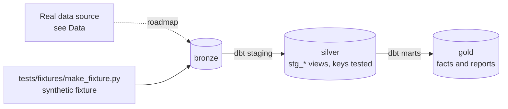

# "Ask the Warehouse": Semantic Layer + AI Agent

[](https://github.com/Saigwe/ask-the-warehouse/actions/workflows/ci.yml)

> Metrics defined once in a semantic layer, an automated check that dashboards match it, and an AI agent that answers questions through the metrics (via MCP), scored on a benchmark with known answers.

**Author:** Stanley Igwe, Lead Data (Analytics) Engineer · [Portfolio](https://saigwe.github.io)
**Stack:** dbt Core · dbt Semantic Layer (MetricFlow) or Cube · MCP server · an LLM (Claude) · DuckDB
**Status:** 🚧 Scaffolded. Fixture pipeline passes: `dbt build` 15/15. See [Roadmap](#roadmap).

Project 12 of my portfolio plan. At a global management consultancy I built governed metrics, plus Power BI data-validation and measure-optimisation models, so every client saw the same numbers. This repo rebuilds the problem on public and synthetic data. No employer or client data, code or logic is used.

---

## 90-second summary
| | |
|---|---|
| **Problem** | TODO: one sentence on the business problem. |
| **What I built** | TODO: fill in as the roadmap lands. |
| **Why it matters** | TODO: the decision this enables, in the user's words. |
| **Proof** | TODO: link to [Numbers](#numbers), with every claim reproducible. |

## Architecture


## Data
Gold marts from projects 1, 3 or 10. CI uses a small synthetic orders and customers fixture so the benchmark runs anywhere.

| Bronze table (fixture) | Rows |
|---|---|
| `bronze.customers` | 500 |
| `bronze.orders` | 5,000 |

## Data model (gold layer, first cut)
| Model | Purpose |
|---|---|
| `fct_orders` | One row per order. Net revenue is defined here, once: refunded orders count as zero. |
| `rpt_daily_revenue` | Report model |

## Tests in place
- Staging: `unique` / `not_null` on every key, and `relationships` on every foreign key
- Marts: grain tests (`unique_combination`) and accepted values
- Business rules: `assert_daily_revenue_matches_orders`

## Numbers
*(Fill from real runs. Never estimate.)*
| Metric | Value |
|---|---|
| Rows processed (real data) | _tbd_ |
| dbt models / tests | _tbd_ |
| `dbt build` runtime | _tbd_ |

## How to run
Requires **Python 3.12** (what CI uses) and `make`, or run the commands in the `Makefile` by hand.
```bash
python -m venv .venv && source .venv/bin/activate   # Windows: .venv\Scripts\activate
pip install -r requirements.txt
make fixture-all   # synthetic fixture -> dbt build (used in CI)
make eval-self-check  # runs the question benchmark's gold SQL against the marts
```

## Roadmap
- [x] Scaffold: synthetic fixture, staging with key tests, first marts and business-rule tests, CI
- [ ] Define the metrics once (MetricFlow semantic models or Cube)
- [ ] Add an automated test that dashboard numbers equal semantic-layer numbers (the Power BI validation idea, in code)
- [ ] Expose metrics to an LLM through an MCP server, with no raw-table access
- [ ] Grow the benchmark to 50+ questions, including ones the agent should refuse
- [ ] Report execution accuracy and latency, and track them in CI
- [ ] Fill in [Numbers](#numbers) and the [design doc](docs/design_doc.md)
- [ ] 3-minute Loom walkthrough

## Interview topics this project prepares
- Semantic layers and metric governance
- LLM-to-SQL evaluation
- Guardrails for AI on data
- Testing BI numbers

## Data and licence
- **Fixture:** synthetic, generated with a fixed seed by `tests/fixtures/make_fixture.py` from `fixture_spec.yml`. It describes no real company or person.
- **Real data:** see [Data](#data) for each source's own licence and terms.
- **Code:** MIT (see `LICENSE`).
